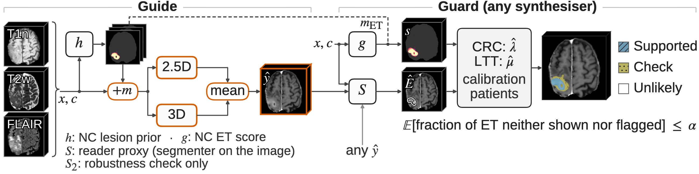
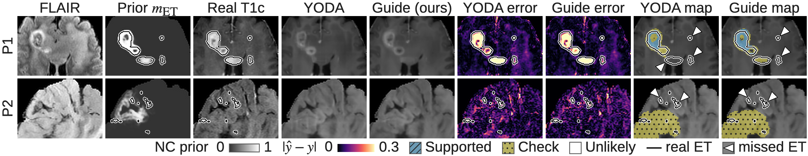

<h1 align="center">
<strong>Guide and Guard: Prior-Guided Virtual-Contrast MRI Synthesis with Conformal Flags for Missed Enhancement</strong>
</h1>

<div align="center">

<a href="https://git.io/typing-svg">

</a>

[](#-citation)
[](https://huggingface.co/Atharva-Rege/guide-guard)
[](#️-data)
[](https://github.com/MIC-DKFZ/nnUNet)
[](LICENSE)
[](https://visitorbadge.io/status?path=https%3A%2F%2Fgithub.com%2Fadinathdukre%2FGuide-Guard)

<h3>🤗 <a href="https://huggingface.co/Atharva-Rege/guide-guard">Weights</a> &nbsp;|&nbsp; 🧠 <a href="#-method">Method</a> &nbsp;|&nbsp; 🏆 <a href="#-results">Results</a> &nbsp;|&nbsp; ⚡ <a href="#-inference">Inference</a> &nbsp;|&nbsp; 🛡️ <a href="#️-guard">Guard</a></h3>

**Atharva Atul Rege, [Adinath Madhavrao Dukre](https://github.com/adinathdukre), Imran Razzak**


</div>

## 🔥 News
- **[Oct 2026]** 🚀 Code, patient-level splits and checkpoints for Guide and Guard are released.
- 📄 The paper is submitted to **IEEE ISBI 2027**.

## Overview
Official code for **Guide and Guard**.

- **Guide** synthesises post-contrast T1 (T1c) from non-contrast (NC) brain MRI (T1n, T2w, FLAIR). Out-of-fold lesion maps from an NC segmenter *h* are fed as extra input channels to two regression synthesisers, and Guide's image is their mean.
- **Guard** attaches a three-level map (**Supported / Check / Unlikely**) to the T1c of *any* synthesiser. Conformal risk control bounds the expected fraction of enhancing tumour (ET) that the image neither shows nor flags (the *miss*), and Learn-then-Test controls false discoveries in the Supported level.

<p align="center">

<br/>
<em><b>Fig. 1.</b> Guide and Guard on the held-out patient of median ET volume. <b>Guide:</b> NC lesion maps m = h(x, c) enter a 2.5D and a 3D regressor, whose mean is ŷ. <b>Guard</b>, for any synthesiser: S, given ŷ in place of the acquired T1c, marks the ET that ŷ shows (Ê); an NC score s (g, or the exploratory (g + m<sub>ET</sub>)/2, dashed) ranks where ET may be missing; CRC/LTT thresholds from separate calibration patients label each voxel. Labels are algorithmic evidence categories, not diagnoses.</em>
</p>

## 📖 Contents
- [🧠 Method](#-method)
- [🏆 Results](#-results)
- [🔍 Qualitative Results](#-qualitative-results)
- [⛏️ Installation](#️-installation)
- [🧩 Pretrained Weights](#-pretrained-weights)
- [🗃️ Data](#️-data)
- [⚡ Inference](#-inference)
- [🛡️ Guard](#️-guard)
- [🏋️ Training](#️-training)
- [🧪 Tests](#-tests)
- [🗂️ Repository Structure](#️-repository-structure)
- [⚠️ Limitations](#️-limitations)
- [📝 Citation](#-citation)
- [📚 Acknowledgments](#-acknowledgments)
- [📨 Contact](#-contact)
- [📜 License](#-license)

## 🧠 Method

1. **Lesion prior.** An NC segmenter *h* (nnU-Net 2D, 5 folds) predicts lesion maps m = WT / TC / ET. Training cases receive their out-of-fold maps, so the synthesisers never see a prior fitted to their own target.
2. **Guide.** The maps are added as input channels to two regression synthesisers: a 2.5D YODA regressor and a 3D nnU-Net with L1 loss (two runs). Guide's image is the mean of the 2.5D member and the averaged 3D runs, with left–right flip test-time augmentation. **Guide-fast** uses the 2.5D member only, without test-time augmentation and with h's fold 0 only.
3. **Guard.** Conformal risk control (CRC) on an NC-only ET score bounds the expected miss. ET that the reader proxy *S* finds on the image counts as covered, so the bound holds for any synthesiser. Learn-then-Test (LTT) controls false discoveries in the Supported level.
4. **Review burden.** Guard's cost is the non-ET volume marked Supported or Check. The same score calibrated without an image (**NC-only CRC**) gives the burden without any image, so the difference measures what the image adds.

Four segmentation networks are used, all nnU-Nets trained on our training split and then frozen:

| Network | Configuration | Role |
|---|---|---|
| *h* | 2D, 5 folds | NC lesion maps m = WT / TC / ET (Guide's prior) |
| *g* | 3D full resolution | NC ET score (Guard's primary score) |
| *S* | 3D full resolution, all four sequences | reader proxy that marks the ET an image shows |
| *S₂* | | robustness check in the paper only; **not released** |

## 🏆 Results

Held-out BraTS 2023 GLI test set (249 cases; burden: score *g*, α = 0.1), as reported in the paper:

<div align="center">

| Method | PSNR ↑ | SSIM ↑ | ET Dice (by S) ↑ | Review burden ↓ |
|---|:---:|:---:|:---:|:---:|
| **Guide** | **23.71 dB** | **0.766** | 0.629 | 27.6 mL |
| Guide-fast | 23.61 dB | 0.765 | 0.632 | 26.3 mL |
| NC-only CRC (no image) | | | 0.646 (of *g*) | 30.7 mL |
| Real T1c (reference) | ∞ | 1.000 | 0.871 | 3.9 mL |

</div>

## 🔍 Qualitative Results

<p align="center">

<br/>
<em><b>Fig. 2.</b> Held-out patients, zoomed (rules fixed in advance): P1 at the 25th percentile of ET volume; P2 a failure case, most of whose small ET lesions are neither shown nor flagged (missed ET). Errors and Guard's maps (α = 0.1, score g).</em>
</p>

## ⛏️ Installation

```bash
git clone https://github.com/adinathdukre/Guide-Guard.git
cd Guide-Guard
```

Three Python environments are needed, because the two Guide members depend on different upstream code bases.

| Env | Used for | Install |
|---|---|---|
| `main` | h, g, S, fusion, Guard | `pip install -r requirements.txt` |
| `yoda` | the 2.5D member | `pip install -r requirements-yoda.txt`, plus a clone of [YODA](https://github.com/Deep-MI/YODA) (commit `86e8dc8`), `export YODA_ROOT=/path/to/YODA` |
| `nnt` | the 3D member | `pip install -e` of [nnUNet_translation](https://github.com/Phyrise/nnUNet_translation) (commit `98f2406`), then `python scripts/install_trainer.py` |

> [!NOTE]
> `ema-pytorch` in `requirements-yoda.txt` is only needed for training.

## 🧩 Pretrained Weights

Download `guide-guard-checkpoints.zip` from [Hugging Face](https://huggingface.co/Atharva-Rege/guide-guard) and unzip it:

```bash
huggingface-cli download Atharva-Rege/guide-guard guide-guard-checkpoints.zip --local-dir .
unzip guide-guard-checkpoints.zip          # -> guide-guard-checkpoints/, used as CKPT below
cd guide-guard-checkpoints && sha256sum -c MANIFEST.txt
```

| Folder | Network | Checkpoint |
|---|---|---|
| `h/` | NC lesion prior *h* (nnU-Net 2d, folds 0–4) | `fold_k/checkpoint_final.pth` |
| `g/` | NC ET score *g* (nnU-Net 3d_fullres, trained on all training cases: fold 5) | `fold_5/checkpoint_final.pth` |
| `S/` | reader proxy *S* (nnU-Net 3d_fullres) | `fold_0/checkpoint_final.pth` |
| `guide25d/` | Guide's 2.5D member (YODA regression + prior, EMA) | `guide25d.pt` |
| `guide3d_r1/`, `guide3d_r2/` | Guide's 3D member, two runs (`nnUNetTrainerGuide3D`) | chosen by `fold_0/selection.json` |

## 🗃️ Data

Inputs are BraTS-layout volumes: SRI24 space, 1 mm, 240 × 240 × 155, skull-stripped. Each case folder holds `<case>-{t1n,t2w,t2f}.nii.gz`, plus `t1c` and `seg` for training or evaluation.

```bash
python scripts/preprocess.py --raw_root /data/BraTS2023-GLI --out VOL     # add --no_target --no_seg for inference-only data
```

Preprocessing:
- The brain mask is the union of the nonzero voxels of the NC inputs.
- NC inputs are clipped to the brain [p0.5, p99.5]; T1c is clipped to the brain [p0.5, p99.9].
- Both are rescaled to [0, 1].

`splits/` holds the patient-level split used in the paper (876 train / 126 val / 249 test cases) and the 5-fold CV of the training cases:

```text
splits/
├── brats23gli_split_v1.csv          # case, patient, split (train / val / test)
└── brats23gli_train_folds_v1.csv    # case, patient, fold (h's 5-fold CV over the training cases)
```

## ⚡ Inference

One command runs the full Guide pipeline (lesion maps, both members, fusion, reader proxy):

```bash
PY_MAIN=/envs/main/bin/python PY_YODA=/envs/yoda/bin/python PY_NNT=/envs/nnt/bin/python \
  bash scripts/run_guide.sh VOL CKPT WORK [--fast] [--cases BraTS-GLI-00000-000 ...]
```

| Output | Contents |
|---|---|
| `WORK/guide/<case>.npy` | Guide T1c (float16, [0, 1], 0 outside the brain) |
| `WORK/maps/{h,g}/<case>.npz` | NC lesion maps (WT, TC, ET) and the NC ET score g |
| `WORK/reader/guide/<case>.npz` | Segmenter S on the synthetic image |

`--fast` runs Guide-fast instead (2.5D member only, no test-time augmentation, h's fold 0 only). Its output goes to `WORK/guide_fast`.

<details>
<summary><strong>Running the steps one at a time</strong></summary>

| Step | Script | Env |
|---|---|---|
| 1. NC lesion maps (h) and NC ET score (g) | `predict_maps.py` | `main` |
| 2. 2.5D member | `predict_guide25d.py` | `yoda` |
| 3. 3D member (each run) | `predict_guide3d.py` | `nnt` |
| 4. Average the 3D runs, then the two members | `fuse_guide.py` | `main` |
| 5. Reader proxy S on the fused image | `predict_reader.py` | `main` |

See `scripts/run_guide.sh` for the exact arguments.

</details>

**Image evaluation.** Image quality and the ET Dice of S, per case (brain PSNR, SSIM and MAE; ET PSNR; ET Dice with `--reader`). LPIPS and the lesion-wise Dice of Table 1 are not computed here.

```bash
python scripts/evaluate_images.py --vol_root VOL --images WORK/guide --reader WORK/reader/guide --out images_eval.csv
```

## 🛡️ Guard

Guard works with any synthesiser. For the images of that synthesiser:

1. Run `predict_reader.py` on its images (and `predict_maps.py --models g`, plus `h` for the averaged score).
2. **Calibrate** on labelled patients who are not used for testing, one timepoint per patient.
3. **Apply** the calibrated thresholds, or **evaluate** them.

```bash
python scripts/guard.py calibrate --vol_root VOL --reader WORK/reader/guide --maps WORK/maps --cases cal.txt \
    --alpha 0.1 --out thresholds.json
python scripts/guard.py apply    --vol_root VOL --reader WORK/reader/guide --maps WORK/maps --cases test.txt \
    --thresholds thresholds.json --out WORK/guard_maps          # uint8: 0 Unlikely, 1 Check, 2 Supported
python scripts/guard.py evaluate --vol_root VOL --reader WORK/reader/guide --maps WORK/maps --cases test.txt \
    --thresholds thresholds.json --out guard_eval.csv          # miss, review burden, Supported FDP
```

| Option | Effect |
|---|---|
| `--score g` (default) | NC ET score g, the paper's primary score |
| `--score avg` | averaged score s = (g + m_ET) / 2 |
| `--no_image` (in place of `--reader`) | NC-only CRC, the image-free baseline map; calibrate, apply and evaluate it the same way. Its burden minus the image's burden is what the image saves |
| `--variant voxel` (default) / `lesion` / `tail` | voxel-level, lesion-level or patient-tail miss loss |

Defaults follow the paper: α = 0.1, β = 0.2, δ = 0.1, ET-positive patients have ≥ 50 ET voxels, and false discoveries lie over 2 mm from the reference ET.

> [!IMPORTANT]
> The guarantee holds marginally, in expectation, for ET-positive test patients exchangeable with the calibration patients. See [Limitations](#️-limitations) before using Guard on a new cohort.

## 🏋️ Training

The released checkpoints are enough for inference and for Guard. Retraining Guide needs the baseline synthesisers retrained on our split, which both members are fine-tuned from. These base weights are not in the Hugging Face repo; a folder `BASE` with them is assumed below:
- `yoda.pt`: YODA in regression mode (20 input channels, 1 output, EMA weights);
- `nnunet_l1.pth`: nnU-Net-L1 (nnUNet_translation `nnUNetTrainerMRCT_mae`, `nnResUNetPlans`).

<details open>
<summary><strong>Step 1. h, g, S (nnU-Net v2, region-based WT/TC/ET)</strong></summary>

```bash
python scripts/make_nnunet_datasets.py --vol_root VOL --split_csv splits/brats23gli_split_v1.csv \
    --folds_csv splits/brats23gli_train_folds_v1.csv
nnUNetv2_plan_and_preprocess -d 511 512
python scripts/make_nnunet_datasets.py --vol_root VOL --split_csv splits/brats23gli_split_v1.csv \
    --folds_csv splits/brats23gli_train_folds_v1.csv --splits_only

for f in 0 1 2 3 4; do nnUNetv2_train 511 2d $f -tr nnUNetTrainer_250epochs --npz; done   # h
nnUNetv2_train 511 3d_fullres 5 -tr nnUNetTrainer_250epochs                               # g
nnUNetv2_train 512 3d_fullres 0 -tr nnUNetTrainer_250epochs                               # S
```

Then write the lesion maps. Training cases get their out-of-fold maps:

```bash
python scripts/predict_maps.py ... \
    --from_cv $nnUNet_results/Dataset511_GuideNC/nnUNetTrainer_250epochs__nnUNetPlans__2d --folds_csv ...
```

All other cases get the 5-fold ensemble: `predict_maps.py --models h`.

</details>

<details open>
<summary><strong>Step 2. 2.5D member (from <code>BASE/yoda.pt</code>)</strong></summary>

```bash
python scripts/train_guide25d.py --vol_root VOL --maps MAPS/h --split_csv splits/brats23gli_split_v1.csv \
    --base_ckpt BASE/yoda.pt --out RUN
python scripts/select_guide25d.py --run_dir RUN --vol_root VOL --maps MAPS/h --split_csv splits/brats23gli_split_v1.csv
```

</details>

<details open>
<summary><strong>Step 3. 3D member (from <code>BASE/nnunet_l1.pth</code>)</strong></summary>

```bash
python scripts/make_guide3d_dataset.py raw --vol_root VOL --maps MAPS/h --split_csv splits/brats23gli_split_v1.csv
nnUNetv2_extract_fingerprint -d 622 && nnUNetv2_plan_experiment -d 622 -pl nnUNetPlannerResUNet
nnUNetv2_preprocess -d 622 -plans_name nnResUNetPlans -c 3d_fullres
python scripts/make_guide3d_dataset.py splits --vol_root VOL --split_csv ...
python scripts/make_guide3d_dataset.py inject --vol_root VOL --split_csv ...
GUIDE3D_INIT=BASE/nnunet_l1.pth nnUNetv2_train 622 3d_fullres 0 -tr nnUNetTrainerGuide3D -p nnResUNetPlans
python scripts/select_guide3d.py --model_dir RESULTS/... --vol_root VOL --maps MAPS/h --split_csv ...
```

The paper averages two independent runs of this step.

</details>

| Setting | 2.5D member | 3D member |
|---|---|---|
| Initialisation | `BASE/yoda.pt` | `BASE/nnunet_l1.pth` |
| Schedule | 25k steps, Adam, cosine 1e-4 → 1e-6 | 400 epochs |
| Loss | MSE + auxiliary WT/TC/ET head (weight 0.005) | L1 + 5 × MSE + auxiliary head (Dice + BCE) |
| Prior dropout | 0.15 | 0.15 |
| Augmentation | left–right flips | left–right flips |
| Selection | best validation brain PSNR (released: step 20k) | best validation brain PSNR; snapshot and tile step in `selection.json` |

## 🧪 Tests

```bash
pip install pytest && python -m pytest -q tests
```

`tests/test_guard.py` checks CRC miss control, the Guard map at λ = 0, the image-free threshold and member fusion.

## 🗂️ Repository Structure

```text
Guide-Guard/
├── guideguard/
│   ├── volumes.py            # BraTS I/O, brain mask, intensity normalisation
│   ├── guide25d.py           # 2.5D member (YODA regression + prior)
│   ├── guide3d.py            # 3D member data and inference helpers
│   ├── fuse.py               # weighted, brain-masked member fusion
│   ├── guard.py              # CRC / LTT calibration, Guard maps, miss and burden
│   ├── metrics.py            # PSNR, SSIM, MAE, Dice
│   ├── nnunet_helpers.py     # nnU-Net dataset and prediction utilities
│   └── nnunet_ext/           # nnUNetTrainerGuide3D (installed by scripts/install_trainer.py)
├── scripts/
│   ├── run_guide.sh          # end-to-end Guide inference
│   ├── preprocess.py         # raw BraTS -> normalised volumes
│   ├── predict_*.py          # h/g maps, 2.5D and 3D members, reader proxy S
│   ├── fuse_guide.py         # member fusion
│   ├── guard.py              # calibrate / apply / evaluate
│   ├── evaluate_images.py    # per-case image metrics
│   ├── make_*_dataset*.py    # nnU-Net dataset builders
│   ├── train_guide25d.py, select_guide25d.py, select_guide3d.py
│   └── install_trainer.py
├── splits/                   # patient-level split and 5-fold CV used in the paper
├── tests/                    # Guard unit tests
├── docs/assets/              # README figures (Fig. 1 method, Fig. 2 qualitative)
├── requirements.txt          # env `main`
└── requirements-yoda.txt     # env `yoda`
```

## ⚠️ Limitations

- The guarantee holds marginally, in expectation, for ET-positive test patients exchangeable with the calibration patients; a single patient, or small lesions, can miss more.
- It did not transfer across sites without recalibration. **Recalibrate at a new site.**
- Guard does not detect out-of-scope cohorts (e.g. meningiomas).
- Labels are algorithmic evidence categories, not diagnoses.
- *S₂*, the second reader proxy used for the robustness check, and the retrained base synthesisers are not released.

## 📝 Citation

If you find our paper and code useful in your research, please cite:

```bibtex
@misc{rege2026guideguard,
  title  = {Guide and Guard: Prior-Guided Virtual-Contrast MRI Synthesis with Conformal Flags for Missed Enhancement},
  author = {Rege, Atharva Atul and Dukre, Adinath Madhavrao and Razzak, Imran},
  note   = {Submitted to IEEE ISBI 2027},
  year   = {2026},
  url    = {https://github.com/adinathdukre/Guide-Guard}
}
```

## 📚 Acknowledgments

The code builds on [YODA](https://github.com/Deep-MI/YODA), [nnU-Net](https://github.com/MIC-DKFZ/nnUNet) and [nnUNet_translation](https://github.com/Phyrise/nnUNet_translation). We thank their authors for sharing their code. The models were trained on the BraTS 2023 GLI data; we thank the BraTS organisers and data contributors.

## 📨 Contact
For questions or collaboration, please open an [issue](https://github.com/adinathdukre/Guide-Guard/issues) or reach out to [Adinath Madhavrao Dukre](https://github.com/adinathdukre).

## 📜 License

The code and model weights are released under Apache-2.0 ([LICENSE](LICENSE)). YODA, nnU-Net and nnUNet_translation are also Apache-2.0. The models were trained on BraTS 2023 GLI (CC BY 4.0).

> [!IMPORTANT]
> Guide and Guard are intended for research only. They are not validated for clinical use and must not inform any diagnostic or treatment decision.
